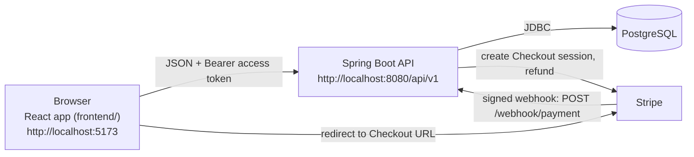
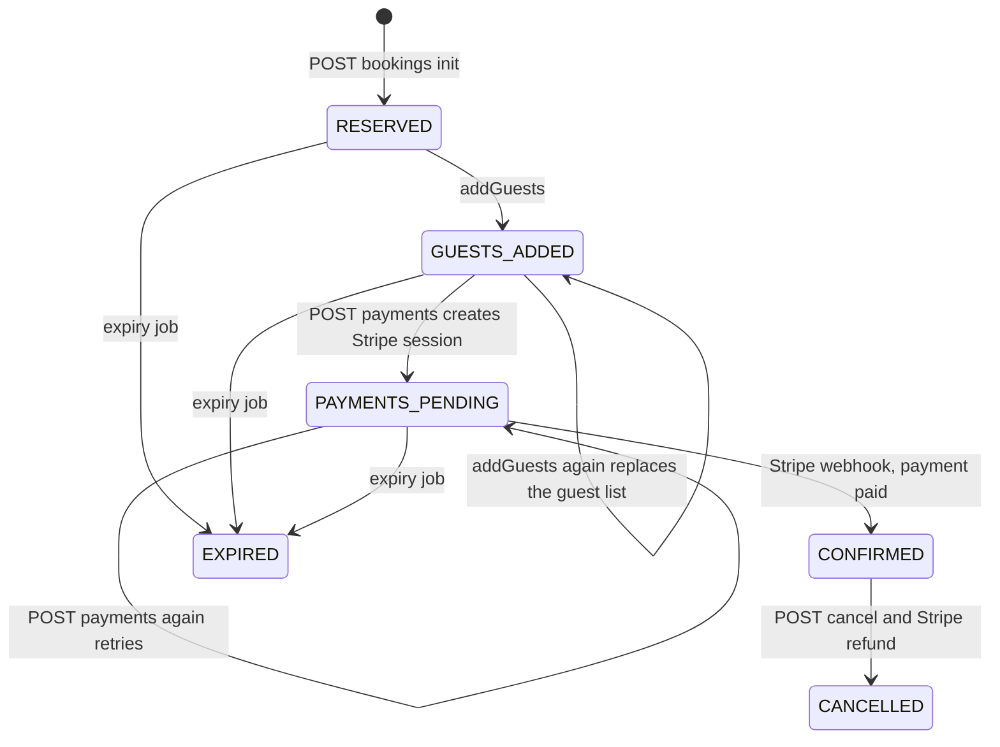

# Hotel Booking Platform (airbnb-backend)

A full-stack hotel / Airbnb-style booking application.

- **Backend** (repository root): Spring Boot REST API, PostgreSQL, JWT authentication, Stripe Checkout payments.
- **Frontend** (`frontend/` folder): React single-page app built with Vite.

> **Documentation status.** This README was written by reading the source code and configuration files. The author of this document could **not** compile the backend, install the frontend packages, start PostgreSQL, or call Stripe while writing it (no network access), so no runtime behaviour was observed. Anything that could not be confirmed from the code is marked **Unverified**. After you have run the project yourself you can delete this note.

---

## Table of contents

1. [Features implemented](#1-features-implemented)
2. [Features not implemented](#2-features-not-implemented)
3. [Technology stack](#3-technology-stack)
4. [Architecture and repository structure](#4-architecture-and-repository-structure)
5. [Prerequisites](#5-prerequisites)
6. [Installation and first run](#6-installation-and-first-run)
7. [Environment variables](#7-environment-variables)
8. [PostgreSQL setup](#8-postgresql-setup)
9. [Running the backend](#9-running-the-backend)
10. [Running the frontend](#10-running-the-frontend)
11. [Stripe test mode](#11-stripe-test-mode)
12. [First-time walkthrough](#12-first-time-walkthrough)
13. [Testing](#13-testing)
14. [Production build](#14-production-build)
15. [Authentication and authorization](#15-authentication-and-authorization)
16. [Booking lifecycle](#16-booking-lifecycle)
17. [Availability and dynamic pricing](#17-availability-and-dynamic-pricing)
18. [API reference](#18-api-reference)
19. [Frontend routes](#19-frontend-routes)
20. [Troubleshooting](#20-troubleshooting)
21. [Deployment](#21-deployment)
22. [Security notes](#22-security-notes)
23. [Known limitations and outstanding issues](#23-known-limitations-and-outstanding-issues)

---

## 1. Features implemented

Each item below was checked in the source code.

**Guests (any logged-in user)**
- Sign up, log in, log out, and silent re-login through a refresh-token cookie.
- Search hotels by city, dates and number of rooms, with pagination.
- Open a hotel and see its rooms with an average price for the chosen dates.
- Create a booking (this reserves the rooms), pick guests, pay through Stripe Checkout, and watch the booking status.
- See booking history and cancel a **confirmed** booking (full refund through Stripe).
- Edit profile (name, date of birth, gender) and manage saved co-travellers ("guests").

**Hotel managers (`HOTEL_MANAGER` role, own hotels only)**
- Create, edit, delete and **activate** hotels.
- Create, edit and delete rooms (type, base price, capacity, total count, amenities, photo URLs).
- View and change per-day inventory (surge factor, closed flag).
- View the bookings of a hotel and a simple report (confirmed bookings, total and average revenue).

**Platform behaviour**
- Dynamic pricing with four strategies (surge, occupancy, urgency, holiday).
- Pessimistic database locks on inventory when reserving, confirming, cancelling and expiring bookings.
- A background job that expires unpaid bookings and releases their rooms.
- Stripe webhook with signature verification; this is the only thing that marks a booking as paid.
- One JSON envelope for all responses, with readable validation errors.
- OpenAPI annotations (springdoc). Whether the Swagger page works at runtime is **Unverified** (see [Troubleshooting](#20-troubleshooting)).

## 2. Features not implemented

Checked by searching the source; none of these exist.

- Role management (no API or screen to make someone a hotel manager).
- Email notifications, email verification, password reset.
- Photo upload (photos are plain URL strings).
- Price, rating or amenity filters and sorting in search.
- Hotel descriptions and ratings.
- Fetching a single booking by id (`GET /bookings/{id}` does not exist; only `/status`).
- Payment providers other than Stripe; currency is fixed to `inr`.
- Dockerfile, CI pipeline, database migrations (Flyway/Liquibase).

## 3. Technology stack

Versions come from `pom.xml` and `frontend/package.json`.

| Layer | Technology |
|---|---|
| Backend | Java 21, Spring Boot 4.1.0 (Web MVC, Security, Data JPA, Validation), Hibernate |
| Database | PostgreSQL (driver version managed by Spring Boot) |
| Authentication | JWT using jjwt 0.12.6 |
| Payments | Stripe Java SDK 32.0.0 |
| Other backend libraries | ModelMapper 3.2.4, springdoc-openapi 2.8.3, Lombok |
| Build tool | Maven through the included wrapper (`mvnw`, `mvnw.cmd`); the wrapper downloads Maven 3.9.16 on first use (value read from `.mvn/wrapper/maven-wrapper.properties`) |
| Frontend | React ^19.0.0, Vite ^6.1.0, React Router ^7.3.0, Axios ^1.8.2, Tailwind CSS ^4.0.5, Radix UI, react-hook-form, zod, dayjs |
| Frontend quality | ESLint ^9.19.0; unit tests with Node's built-in test runner |

## 4. Architecture and repository structure



Repository layout (backend at the root, frontend in `frontend/`):

```
airbnb-backend/
├── README.md                       <- this file
├── pom.xml                         <- Maven build (Java 21, Spring Boot 4.1.0)
├── mvnw, mvnw.cmd, .mvn/           <- Maven wrapper
├── .env.example                    <- backend variable template (placeholders only)
├── .gitignore, .gitattributes
├── src/
│   ├── main/java/com/muzammil/projects/airBnbApp/
│   │   ├── controller/             <- REST endpoints
│   │   ├── service/                <- business logic, BookingExpiryService, PricingUpdateService
│   │   ├── strategy/               <- dynamic pricing strategies
│   │   ├── security/               <- JWT filter and service, Spring Security configuration
│   │   ├── config/                 <- CORS, OpenAPI, Stripe, ModelMapper
│   │   ├── advice/                 <- global error handler and response envelope
│   │   └── entity/, repository/, dto/, exception/, util/
│   ├── main/resources/application.properties
│   └── test/java/.../AirBnbAppApplicationTests.java
└── frontend/
    ├── package.json, vite.config.js, eslint.config.js
    ├── .env.example                <- frontend variable template
    ├── README.md                   <- original Vite template text, not project documentation
    └── src/
        ├── app/                    <- pages (home, search, hotel-details, checkout, payments, settings, admin)
        ├── components/, features/, hooks/
        ├── config/                 <- api.config.js (endpoint paths), path.config.js (routes)
        └── lib/                    <- axios client, hooks, providers, __tests__/
```

**Check the layout on your own machine** (Git Bash, from the repository folder). All lines should print a path and not "No such file":

```bash
ls pom.xml mvnw .env.example src/main/resources/application.properties
ls frontend/package.json frontend/.env.example
```

If these fail, the repository has a different layout than this README assumes; adjust the paths in the commands below.

## 5. Prerequisites

| Tool | Requirement | Type |
|---|---|---|
| JDK | Java **21** | Enforced: `<java.version>21</java.version>` in `pom.xml` |
| Maven | Not needed; `./mvnw` is included | - |
| PostgreSQL | A running server you can create a database on | Required. No version is pinned by the project (minimum **Unverified**). |
| Node.js and npm | Needed for the frontend | Required. No `engines` field exists, so no minimum is enforced; use a current LTS release. |
| Git for Windows (Git Bash) | To run the commands in this README | Recommendation |
| Stripe account (test mode) and Stripe CLI | Only to test payments | Required for payments |

Check what you have installed:

```bash
java -version      # must show version 21
node -v
npm -v
git --version
```

## 6. Installation and first run

Each numbered step says which terminal to use. Keep the backend and frontend terminals **open** while you use the app.

1. **Clone** (any terminal):
   ```bash
   git clone https://github.com/Muzzu321/airbnb-backend.git
   cd airbnb-backend
   ```
2. **Create the database** - see [PostgreSQL setup](#8-postgresql-setup).
3. **Create the backend `.env` file** and fill it in - see [Environment variables](#7-environment-variables).
4. **Terminal 1 - backend**: load the variables and start the API - see [Running the backend](#9-running-the-backend).
5. **Terminal 2 - frontend**: install packages and start the dev server - see [Running the frontend](#10-running-the-frontend).
6. Open `http://localhost:5173` in the browser.
7. For hotel management and payments continue with [First-time walkthrough](#12-first-time-walkthrough).

## 7. Environment variables

### Backend

The backend reads these from **operating-system environment variables**. Spring Boot does **not** read a `.env` file by itself. The `.env` file in this project is only a convenient place to write the values; you must load it into your terminal (shown below) before starting the app. The variables exist only in that one terminal window; open a new window and you must load them again.

Source of truth: `src/main/resources/application.properties`.

| Variable | Required | Default | Purpose |
|---|---|---|---|
| `DB_PASSWORD` | **Yes** | none | PostgreSQL password |
| `JWT_SECRET` | **Yes** | none | Key that signs login tokens. Use at least 32 characters: jjwt's HMAC key helper rejects shorter HS256 keys (library behaviour, not tested here). |
| `STRIPE_SECRET_KEY` | **Yes** | none | Stripe secret key (`sk_test_...` while developing) |
| `STRIPE_WEBHOOK_SECRET` | **Yes** | none | Webhook signing secret (`whsec_...`) |
| `DB_URL` | No | `jdbc:postgresql://localhost:5432/airBnb` | JDBC URL |
| `DB_USERNAME` | No | `airbnb_user` | Database user |
| `FRONTEND_URL` | No | `http://localhost:5173` | URL of the React app; Stripe sends the customer back here, and it is the default CORS origin |
| `CORS_ALLOWED_ORIGINS` | No | value of `FRONTEND_URL` | Comma-separated exact origins allowed to call the API. A `*` makes the app refuse to start. |
| `COOKIE_SECURE` | No | `false` | `true` adds the `Secure` flag to the refresh cookie (needs HTTPS) |
| `COOKIE_SAME_SITE` | No | `Lax` | `SameSite` value of the refresh cookie (`Lax`, `Strict`, `None`); `None` only works together with `COOKIE_SECURE=true` |
| `JPA_DDL_AUTO` | No | `update` | Hibernate schema mode |
| `JPA_SHOW_SQL` | No | `false` | Print SQL statements |
| `SERVER_PORT` | No | `8080` | HTTP port |

If a required variable is missing, startup fails with an error such as `Could not resolve placeholder 'DB_PASSWORD'`.

**Create the `.env` file (Git Bash, repository folder):**

```bash
cp .env.example .env
```

Open `.env` in an editor (for example VS Code) and replace the placeholders. Rules that avoid common Windows problems:

- Save the file with **LF** line endings (VS Code: click `CRLF` in the bottom bar and choose `LF`). If it already has Windows line endings, fix it with: `sed -i 's/\r$//' .env`
- If a value contains special characters (`$`, `&`, spaces, `#`), put it in **single quotes**: `DB_PASSWORD='pa$$w0rd'`
- Never commit `.env`. Confirm Git ignores it: `git check-ignore -v .env` should print a matching `.gitignore` rule. If it prints nothing, add `.env` to `.gitignore` before doing anything else.
- Make up a random `JWT_SECRET`, for example with: `openssl rand -base64 48`

**Loading the variables (do this in the terminal that will start the backend):**

*Git Bash:*
```bash
set -a; source .env; set +a
# check without printing secrets:
[ -n "$DB_PASSWORD" ] && echo "DB_PASSWORD is set" || echo "DB_PASSWORD is MISSING"
```

*PowerShell:*
```powershell
Get-Content .env | ForEach-Object {
  if ($_ -match '^\s*([A-Za-z_][A-Za-z0-9_]*)=(.*)$') {
    [Environment]::SetEnvironmentVariable($matches[1], $matches[2].Trim("'").Trim('"'), 'Process')
  }
}
```

*Command Prompt (cmd.exe)*: no loader; set each variable by hand, one per line, no quotes and no spaces around `=`:
```bat
set DB_PASSWORD=your-password
set JWT_SECRET=your-long-random-secret
set STRIPE_SECRET_KEY=sk_test_your_key
set STRIPE_WEBHOOK_SECRET=whsec_your_secret
```

An IDE (IntelliJ IDEA, VS Code) can also hold these variables in its run configuration instead.

### Frontend

File: `frontend/.env` (copy from `frontend/.env.example`).

| Variable | Required | Default | Purpose |
|---|---|---|---|
| `VITE_SERVER_BASE_URL` | No | `http://localhost:8080/api/v1` | Base URL of the API, **including** `/api/v1` (endpoint paths in `frontend/src/config/api.config.js` do not repeat it) |

```bash
cd frontend
cp .env.example .env
cd ..
```

Important facts about Vite variables:
- Only variables that start with `VITE_` are available to the frontend code.
- Their values are copied into the JavaScript files that every visitor downloads. **`VITE_*` values are public. Never put a password, key or secret in them.**
- They are read when the dev server starts or the app is built; after editing `.env`, stop and restart `npm run dev`.
- `frontend/.gitignore` lists `.env`. Check that it is not already tracked: `git ls-files frontend/.env` should print nothing. If it prints a path, run `git rm --cached frontend/.env` and commit.

## 8. PostgreSQL setup

The project has **no migration tool**. With the default `JPA_DDL_AUTO=update`, Hibernate creates the tables the first time the backend starts, so you only need an empty database and a user.

1. Install PostgreSQL (Windows installer from postgresql.org, or Docker). Note the password you set for the `postgres` superuser.
   Optional Docker alternative:
   ```bash
   docker run --name airbnb-pg -e POSTGRES_PASSWORD=postgres -p 5432:5432 -d postgres:16
   ```
2. Open a SQL prompt. In Git Bash: `psql -U postgres -h localhost` (if `psql` is "command not found", add `C:\Program Files\PostgreSQL\<version>\bin` to your PATH, or paste the SQL into the Query Tool in pgAdmin).
3. Run:
   ```sql
   CREATE USER airbnb_user WITH PASSWORD 'choose-a-password';
   CREATE DATABASE "airBnb" OWNER airbnb_user;
   ```
   The double quotes matter: PostgreSQL lowercases unquoted names, but the default `DB_URL` uses the mixed-case name `airBnb`.
4. Put the same password into `DB_PASSWORD` in `.env`. If you used other names, set `DB_URL` and `DB_USERNAME` too.

Tables appear on the first backend start. There is no seed data, so the app starts empty.

### Making a user a hotel manager

Sign-up always creates a plain `GUEST` (`AuthService`), and no API changes roles, so the first manager must be created directly in the database. Register in the app first, then:

**Step 1: find the roles table** (names are generated by Hibernate and were **not** observed at runtime):

```sql
\c "airBnb"
SELECT table_name, column_name FROM information_schema.columns WHERE column_name = 'roles';
\d user_roles
```

What the mappings in `User.java` imply: the user table is `app_user` (explicit `@Table`) with columns `id` and `email`; roles are an `@ElementCollection` with no `@CollectionTable`, stored as text (`@Enumerated(EnumType.STRING)`) in a separate table that Hibernate names from the entity name and field, which is expected to be **`user_roles`** with columns **`user_id`** and **`roles`** (**Unverified** until you run the app; use the output of step 1 if it differs).

**Step 2: grant the role** (replace the email):

```sql
INSERT INTO user_roles (user_id, roles)
SELECT id, 'HOTEL_MANAGER' FROM app_user WHERE email = 'you@example.com';

SELECT * FROM user_roles;   -- should now list GUEST and HOTEL_MANAGER for that user
```

Log out and log in again so a fresh profile is loaded; an **Admin** entry then appears in the account menu.

## 9. Running the backend

**Terminal 1**, from the repository folder:

```bash
set -a; source .env; set +a        # Git Bash: load variables (see section 7)
./mvnw spring-boot:run             # Windows cmd/PowerShell: mvnw.cmd spring-boot:run
```

The first run downloads Maven and all dependencies, which takes a while and needs internet access. Keep this terminal open.

**How to know it worked**
- The log ends with a line like `Started AirBnbAppApplication in ... seconds` (main class `AirBnbAppApplication`).
- In another terminal, this should return HTTP 200 and an empty page of results:
  ```bash
  curl -i "http://localhost:8080/api/v1/hotels/search?city=Nowhere&startDate=2030-01-01&endDate=2030-01-02"
  ```
- To stop: press `Ctrl+C` in that terminal.

The API lives under the context path `/api/v1` on port 8080 (`server.servlet.context-path=/api/v1`).

## 10. Running the frontend

**Terminal 2**, from the repository folder:

```bash
cd frontend
npm install
npm run dev
```

`npm install` is needed once (and after dependency changes). Vite prints a local address, normally `http://localhost:5173`. Open it. Keep this terminal open.

Note: if port 5173 is busy, Vite switches to another port such as 5174; the backend would then reject browser requests (CORS). Either free port 5173 or set `CORS_ALLOWED_ORIGINS` and `FRONTEND_URL` to the new address and restart the backend.

Always open the app using the same host name as configured: `http://localhost:5173` and `http://127.0.0.1:5173` are different origins to CORS.

## 11. Stripe test mode

You need this only to complete payments.

1. Create a free Stripe account and stay in **test mode**. Copy the test secret key (`sk_test_...`) from the Stripe Dashboard into `STRIPE_SECRET_KEY`.
2. Install the Stripe CLI (see Stripe's documentation for Windows) and run:
   ```bash
   stripe login
   stripe listen --forward-to localhost:8080/api/v1/webhook/payment
   ```
   Leave this **third terminal** open. It prints a signing secret starting with `whsec_`.
3. Put that value in `STRIPE_WEBHOOK_SECRET` in `.env`, then stop the backend, reload the variables and start it again.
4. At the Stripe Checkout page pay with the test card `4242 4242 4242 4242`, any future expiry date, any 3-digit CVC and any postal code.

Without `stripe listen` running, the payment succeeds at Stripe but the booking stays in `PAYMENTS_PENDING`, because only the webhook confirms payment.

The currency is hard-coded to `inr` in `CheckoutServiceImpl`; whether your Stripe account can charge in INR is **Unverified**.

## 12. First-time walkthrough

1. Open `http://localhost:5173/signup` and create an account.
2. [Make that user a hotel manager](#making-a-user-a-hotel-manager), then log out and in.
3. Account menu -> **Admin** -> create a hotel (name and city are required).
4. Open the hotel -> **Rooms** -> create a room (type, base price, total count and capacity are required).
5. On the hotel overview click **Activate hotel**. This creates one year of daily inventory for each room and makes the hotel searchable. A hotel cannot be activated twice.
6. Go to the home page and search for the hotel's **city** (any letter case) with future dates.
7. Open the hotel, pick a room, continue to checkout. Rooms are reserved when the checkout page opens.
8. Add a saved guest (create one in the dialog), then click to pay. You are redirected to Stripe; pay with the test card.
9. You return to the status page, which checks the booking every 3 seconds (up to 20 times). With the webhook running it shows `CONFIRMED`.
10. **My bookings** shows the booking; **Cancel booking** refunds it through Stripe.

## 13. Testing

| What | Command (folder) | External requirements |
|---|---|---|
| Frontend unit tests | `npm test` (`frontend/`) | None. Runs `node --test src/lib/__tests__/*.test.js` (error normalisation, single-flight token refresh). No `npm install` needed because the tests have no dependencies. |
| Frontend lint | `npm run lint` (`frontend/`) | `npm install` first. Needs no services. |
| Backend tests | `./mvnw test` (root) | **PostgreSQL running** and the **four required variables** set (see below). Maven needs internet on first run. |

The backend has exactly one test, `AirBnbAppApplicationTests.contextLoads`, annotated `@SpringBootTest`. It starts the whole application with the real `application.properties` (there is no `src/test/resources`), so it is an integration check, not an isolated unit test: it needs a reachable database with valid credentials, and the properties without defaults (`DB_PASSWORD`, `JWT_SECRET`, `STRIPE_SECRET_KEY`, `STRIPE_WEBHOOK_SECRET`) must be set. Stripe is not contacted at startup (the code only stores the key), so a dummy value should be enough for the Stripe variables (**Unverified**). Nothing tests bookings, payments, pricing or security.

There are no browser (end-to-end) tests; no such tool is in `frontend/package.json`.

## 14. Production build

**Backend** (root folder):
```bash
./mvnw clean package -DskipTests
```
`-DskipTests` is used because the only test needs a database. The build is expected to produce `target/airBnbApp-0.0.1-SNAPSHOT.jar`: the name follows from `artifactId` `airBnbApp` and version `0.0.1-SNAPSHOT` in `pom.xml`, no `finalName` override exists, and the Spring Boot Maven plugin is declared (**Unverified**: not built here; run `ls target/*.jar` to see the real name). Run it with the environment variables loaded:
```bash
java -jar target/airBnbApp-0.0.1-SNAPSHOT.jar
```

**Frontend** (`frontend/` folder):
```bash
VITE_SERVER_BASE_URL=https://api.example.com/api/v1 npm run build
npm run preview        # optional: serve the build locally
```
The result is in `frontend/dist/`. Serve it from any static host. The app uses browser-side routing, so the host must return `index.html` for unknown paths (otherwise reloading `/search` gives 404). `VITE_SERVER_BASE_URL` is baked into the build, so build separately for each environment. (In Windows cmd/PowerShell set the variable first: `set VITE_SERVER_BASE_URL=...` / `$env:VITE_SERVER_BASE_URL="..."`, or put it in `frontend/.env`.)

## 15. Authentication and authorization

**Tokens**
- `POST /auth/login` returns `{ "accessToken": "..." }` and sets an **HttpOnly cookie** named `refreshToken` (path `/api/v1/auth`, 180 days, `Secure` and `SameSite` from the environment variables).
- The **access token** is a JWT valid for **10 minutes**; the browser sends it as `Authorization: Bearer <token>`. The React app keeps it in `localStorage` under the key `__auth-token__`.
- The **refresh token** is a JWT valid about **180 days**, readable only by the server through the cookie. When an API call returns `401`, the frontend sends **one** shared `POST /auth/refresh` (cookie included) and retries the original call once; if the refresh fails, the user is logged out locally.
- `POST /auth/logout` clears the cookie. Tokens are stateless, so an access token issued earlier remains valid until it expires.

**Roles**: `GUEST` (default for everyone) and `HOTEL_MANAGER`.

| URL pattern | Rule (from `WebSecurityConfig`) |
|---|---|
| `/admin/**` | role `HOTEL_MANAGER` |
| `/bookings/**`, `/users/**` | any authenticated user |
| everything else, including `/auth/**`, `/hotels/**`, `/webhook/**` | open at the Spring Security level |

**Ownership checks** (in the services, on top of the role): a manager can only read or change hotels, rooms, inventory, bookings and reports of **hotels they own**; a user can only read, change, pay or cancel **their own** bookings, and can only attach **their own** saved guests to a booking. Violations return `403`.

**Other behaviour**
- No token or an invalid/expired token -> `401`; wrong role or foreign resource -> `403`.
- CORS allows only the origins in `CORS_ALLOWED_ORIGINS`, the methods GET, POST, PUT, PATCH, DELETE, OPTIONS, the headers `Authorization`, `Content-Type`, `Accept`, and credentials (cookies).
- The route guards in the React app only hide pages; the backend decides access on its own.

**Cookies locally vs. with HTTPS**
- Local development: `http://localhost:5173` (app) and `http://localhost:8080` (API) count as the *same site*, so the defaults `COOKIE_SECURE=false`, `COOKIE_SAME_SITE=Lax` are what the code expects (not runtime-tested).
- Production over HTTPS: set `COOKIE_SECURE=true`. If the app and API share a registrable domain (for example `app.example.com` and `api.example.com`), keep `Lax`. If they are on different sites, use `COOKIE_SAME_SITE=None` together with `COOKIE_SECURE=true`.
- `CORS_ALLOWED_ORIGINS` must contain the exact origin of the app (scheme, host, port, no trailing slash), for example `https://app.example.com`.

## 16. Booking lifecycle

Statuses (enum `BookingStatus`): `RESERVED`, `GUESTS_ADDED`, `PAYMENTS_PENDING`, `CONFIRMED`, `CANCELLED`, `EXPIRED`.



Step by step:

1. **`POST /bookings/init`** checks the dates (check-in not in the past, check-out after check-in), that the room belongs to the hotel, and that every date in the range has enough free rooms. It locks those inventory rows, increases their reserved count and stores the booking as `RESERVED` with the amount computed on the server.
2. **`POST /bookings/{id}/addGuests`** takes the full list of guest ids (at least one, all owned by the caller). The list **replaces** earlier guests. Allowed only in `RESERVED` or `GUESTS_ADDED`, and only within 10 minutes of creation.
3. **`POST /bookings/{id}/payments`** is allowed only in `GUESTS_ADDED` or `PAYMENTS_PENDING`, and only within 10 minutes of creation. On a retry from `PAYMENTS_PENDING` the earlier Stripe session is closed first; if Stripe reports it as already paid, the call fails with `409`. It creates a Stripe Checkout session (mode `payment`, currency `inr`) and returns its URL. The success URL is `FRONTEND_URL/payments/{id}/status`; the cancel URL is the same with `?cancelled=true`.
4. **The Stripe webhook** (`POST /webhook/payment`) verifies the signature with `STRIPE_WEBHOOK_SECRET`. For `checkout.session.completed` with `payment_status` = `paid` it sets `CONFIRMED` and converts the reserved rooms into booked rooms. A repeated delivery of the same event is ignored. Returning from Stripe's page does **not** confirm anything.
5. **`GET /bookings/{id}/status`** is polled by the frontend every 3 seconds, at most 20 times, until `CONFIRMED`, `CANCELLED` or `EXPIRED`. If time runs out, the page says confirmation is still pending instead of reporting failure.
6. **`POST /bookings/{id}/cancel`** works only for `CONFIRMED` bookings: it locks inventory, releases the rooms, and refunds the payment in full through Stripe. If the refund call fails, the whole operation is rolled back and the booking stays `CONFIRMED` (`409`).

### Expiry periods

Two separate clocks exist. They are not the same thing.

| Clock | Length | Counted from | What happens |
|---|---|---|---|
| Booking window to add guests and **start** payment | 10 minutes | booking creation | After this, `addGuests` and `payments` return `409 Booking has already expired`. |
| Expiry job for `RESERVED` / `GUESTS_ADDED` | runs every 60 s; acts on bookings older than 10 minutes | booking creation | Status -> `EXPIRED`, reserved rooms released. |
| Stripe Checkout session | 30 minutes (`setExpiresAt`) | creation of that session | Stripe stops accepting payment on it. |
| Expiry job for `PAYMENTS_PENDING` | acts on bookings last updated more than 35 minutes ago | the moment payment was started (or retried) | Status -> `EXPIRED`, reserved rooms released. |

What this means in practice:
- Once payment has started, the rooms stay reserved for up to **35 minutes** from that moment (not 10), which is deliberately longer than the 30-minute Stripe session, so a session cannot normally still be payable after its booking expired.
- The webhook does **not** look at the booking's age. It confirms any booking that is still `PAYMENTS_PENDING`. If a payment arrives for a booking that is already `EXPIRED` or `CANCELLED`, the code only writes an error log line saying a manual refund/review is needed; **no automatic refund happens**.

## 17. Availability and dynamic pricing

**Inventory.** Activating a hotel (`PATCH /admin/hotels/{id}/activate`) creates one inventory row per room per day, from today to one year ahead. Each row holds `totalCount`, `bookedCount`, `reservedCount`, `price`, `surgeFactor` and `closed`. Rooms created later in an already-active hotel get their rows automatically.

**Search** (`GET /hotels/search`) reads a precomputed `hotel_min_price` table: matching is on city (case-insensitive), the date range, and `active = true`. That table is refreshed by a job every hour on the hour (`0 0 * * * *`) and immediately for a hotel when it is activated. The search query does **not** check room availability (see [limitations](#23-known-limitations-and-outstanding-issues)).

**Hotel info** (`GET /hotels/{id}/info`) returns each room that has at least one day in the range with free rooms (`totalCount - bookedCount >= roomsCount`, not closed). The room's `price` is the average over the range, but it is `null` unless **every** day in the range qualifies, so a `null` price means "not available for all selected dates". This check ignores `reservedCount`, so a room that others have reserved but not yet paid for can still look available here and then be rejected with `409` at booking time.

**Price of one inventory day** (`PricingService` applies these in order):

1. Base: the room's `basePrice`.
2. Surge: multiplied by the day's `surgeFactor` (set by a manager).
3. Occupancy: x1.2 if `bookedCount / totalCount` is above 0.8.
4. Urgency: x1.15 if the date is within the next 7 days (today included).
5. Holiday: x1.25 (the condition is hard-coded; see limitations).

The booking `amount` = sum of that price over all dates from check-in **through** check-out (both included) x number of rooms, computed on the server when the booking is created. Prices shown in search and on the hotel page are averages of stored daily prices, so treat them as estimates.

## 18. API reference

Base URL (local): `http://localhost:8080/api/v1`

Auth column: **Public** = no token; **User** = valid access token; **Manager** = `HOTEL_MANAGER` token and ownership of the hotel; **Cookie** = refresh cookie.

### Response and error format

Every JSON response is wrapped in an envelope:

```json
{ "timeStamp": "2026-10-10T10:00:00", "data": { }, "error": null }
```

Errors:

```json
{ "timeStamp": "2026-10-10T10:00:00", "data": null,
  "error": { "status": "BAD_REQUEST", "message": "Validation failed",
             "subErrors": ["email: must be a well-formed email address"] } }
```

| HTTP code | Meaning in this API |
|---|---|
| 400 | Validation error, malformed JSON, bad parameter, bad date range, invalid Stripe signature on the webhook |
| 401 | Missing/invalid/expired token, wrong login, missing refresh cookie |
| 403 | Role missing, or the resource belongs to someone else |
| 404 | Hotel, room, booking, guest or user not found |
| 409 | Business-rule conflict: booking expired or in the wrong state, room not available, refund failed, hotel already active (also the mapping for database constraint violations) |
| 500 | Unexpected error (generic message; details only in the server log) |

Dates use `YYYY-MM-DD`. Responses that return **204** have no body.

### Auth

| Method | Path | Auth | Request | Success |
|---|---|---|---|---|
| POST | `/auth/signup` | Public | `{"name","email","password"}`; all required, valid email, password 8-72 characters | 201 user (`id,email,name,gender,dateOfBirth,roles`); 409 if the email exists |
| POST | `/auth/login` | Public | `{"email","password"}` | 200 `{"accessToken"}` + `Set-Cookie: refreshToken`; 401 on wrong credentials |
| POST | `/auth/refresh` | Cookie | no body | 200 `{"accessToken"}`; 401 if the cookie is missing or invalid |
| POST | `/auth/logout` | Public | no body | 204 and the cookie is cleared |

```bash
curl -X POST http://localhost:8080/api/v1/auth/signup -H "Content-Type: application/json" \
  -d '{"name":"Asha","email":"asha@example.com","password":"S3cure-pass"}'

curl -i -X POST http://localhost:8080/api/v1/auth/login -H "Content-Type: application/json" \
  -d '{"email":"asha@example.com","password":"S3cure-pass"}'
```

### Hotel browsing (Public)

| Method | Path | Query parameters | Success |
|---|---|---|---|
| GET | `/hotels/search` | `city`, `startDate`, `endDate` required; `roomsCount` 1-20 (default 1); `page` >= 0 (default 0); `size` 1-50 (default 10) | 200 Spring `Page`: `content[]` of `{id,name,city,photos,amenities,contactInfo,price}` plus paging fields (`totalElements`, ...) |
| GET | `/hotels/{hotelId}/info` | `startDate`, `endDate` required; `roomsCount` 1-20 (default 1) | 200 `{"hotel": {...}, "rooms": [{id,type,photos,amenities,price}]}`; 404 unknown hotel |

`endDate` before `startDate` -> 400.

```bash
curl "http://localhost:8080/api/v1/hotels/search?city=Goa&startDate=2026-11-01&endDate=2026-11-03&roomsCount=1&page=0&size=10"
curl "http://localhost:8080/api/v1/hotels/1/info?startDate=2026-11-01&endDate=2026-11-03&roomsCount=1"
```

### User profile and saved guests (User)

| Method | Path | Request | Success |
|---|---|---|---|
| GET | `/users/profile` | none | 200 user incl. `roles` |
| PATCH | `/users/profile` | `{"name","dateOfBirth","gender"}` (`gender`: `MALE`, `FEMALE`, `OTHER`) | 204 |
| GET | `/users/myBookings` | none | 200 list of bookings |
| GET | `/users/guests` | none | 200 list of guests |
| POST | `/users/guests` | `{"name","gender","dateOfBirth"}`; `name` required | 201 guest |
| PUT | `/users/guests/{guestId}` | same as POST | 204 |
| DELETE | `/users/guests/{guestId}` | none | 204 |

### Bookings (User; owner only, otherwise 403)

A booking object contains: `id`, `hotel`, `room`, `user`, `roomsCount`, `checkInDate`, `checkOutDate`, `createdAt`, `updatedAt`, `bookingStatus`, `guests[]`, `amount`.

| Method | Path | Request | Success |
|---|---|---|---|
| POST | `/bookings/init` | `{"hotelId","roomId","checkInDate","checkOutDate","roomsCount"}`; all required, `roomsCount` 1-20 | 200 booking with `RESERVED`; 400 bad dates or room not in hotel; 404; 409 not available |
| POST | `/bookings/{bookingId}/addGuests` | JSON array of guest ids, for example `[3,4]` | 200 booking with `GUESTS_ADDED`; 400 empty list; 403 guest not yours; 409 expired or wrong state |
| POST | `/bookings/{bookingId}/payments` | none | 200 `{"sessionUrl": "https://checkout.stripe.com/..."}`; 409 expired or wrong state |
| GET | `/bookings/{bookingId}/status` | none | 200 `{"bookingStatus": "CONFIRMED"}` |
| POST | `/bookings/{bookingId}/cancel` | none | 204; 409 unless the booking is `CONFIRMED` or if the refund fails |

```bash
TOKEN="paste-the-accessToken-here"
curl -X POST http://localhost:8080/api/v1/bookings/init \
  -H "Authorization: Bearer $TOKEN" -H "Content-Type: application/json" \
  -d '{"hotelId":1,"roomId":1,"checkInDate":"2026-11-01","checkOutDate":"2026-11-03","roomsCount":1}'
```

### Webhook (called by Stripe only)

| Method | Path | Auth | Success |
|---|---|---|---|
| POST | `/webhook/payment` | `Stripe-Signature` header, verified with `STRIPE_WEBHOOK_SECRET` | 204; 400 on an invalid signature |

### Admin - hotels (Manager)

Hotel body: `{"name","city","photos":[],"amenities":[],"contactInfo":{"address","phoneNumber","email","location"}}` (`name` and `city` required).

| Method | Path | Request | Success |
|---|---|---|---|
| GET | `/admin/hotels` | none | 200 list of **your** hotels |
| POST | `/admin/hotels` | hotel body | 201 hotel; created **inactive** |
| GET | `/admin/hotels/{hotelId}` | none | 200 hotel |
| PUT | `/admin/hotels/{hotelId}` | hotel body (may include `active`) | 200 hotel |
| DELETE | `/admin/hotels/{hotelId}` | none | 204; a conflict (409 expected, **Unverified**) if bookings reference it |
| PATCH | `/admin/hotels/{hotelId}/activate` | none | 204; 409 if already active |
| GET | `/admin/hotels/{hotelId}/bookings` | none | 200 list of bookings (includes the booker's user data) |
| GET | `/admin/hotels/{hotelId}/reports` | optional `startDate`, `endDate` (defaults: one month ago to today) | 200 `{"bookingCount","totalRevenue","avgRevenue"}`, counting `CONFIRMED` bookings **created** in the range |

### Admin - rooms and inventory (Manager)

Room body: `{"type","basePrice","photos":[],"amenities":[],"totalCount","capacity"}` (`type` required; `basePrice` at least 0.01; `totalCount` and `capacity` at least 1).

| Method | Path | Request | Success |
|---|---|---|---|
| GET | `/admin/hotels/{hotelId}/rooms` | none | 200 list of rooms |
| POST | `/admin/hotels/{hotelId}/rooms` | room body | 201 room (inventory created at once if the hotel is active) |
| GET | `/admin/hotels/{hotelId}/rooms/{roomId}` | none | 200 room |
| PUT | `/admin/hotels/{hotelId}/rooms/{roomId}` | room body | 200 room (does not change existing inventory) |
| DELETE | `/admin/hotels/{hotelId}/rooms/{roomId}` | none | 204; a conflict (409 expected, **Unverified**) if bookings reference it |
| GET | `/admin/inventory/rooms/{roomId}` | none | 200 list of `{id,date,bookedCount,reservedCount,totalCount,surgeFactor,price,closed,createdAt,updatedAt}` |
| PATCH | `/admin/inventory/rooms/{roomId}` | `{"startDate","endDate","surgeFactor","closed"}`; `surgeFactor` at least 1.0 | 204 |

## 19. Frontend routes

Defined in `frontend/src/config/path.config.js` and `frontend/src/app/router.jsx`. There is no catch-all route, so an unknown URL renders an empty page.

| Route | Page | Login needed |
|---|---|---|
| `/` | Home | no |
| `/search` | Search results (query: city, dates, rooms, page) | no |
| `/hotels/:id` | Hotel details and room selection | no |
| `/signin`, `/signup` | Authentication | no |
| `/hotels/:id/checkout` | Checkout (creates the booking; query carries room and dates) | yes |
| `/payments/:bookingId/status` | Payment status page (Stripe return target) | yes |
| `/me/profile` | Profile | yes |
| `/me/booking-history` | Booking history and cancellation | yes |
| `/me/travelers` | Saved co-travellers | yes |
| `/admin` | List of your hotels | yes + `HOTEL_MANAGER` |
| `/admin/hotels/create` | Create hotel | yes + `HOTEL_MANAGER` |
| `/admin/hotels/:hotelId` | Redirects to `overview` | yes + `HOTEL_MANAGER` |
| `/admin/hotels/:hotelId/overview` | Hotel overview, report, activation | yes + `HOTEL_MANAGER` |
| `/admin/hotels/:hotelId/edit` | Edit hotel | yes + `HOTEL_MANAGER` |
| `/admin/hotels/:hotelId/bookings` | Hotel bookings | yes + `HOTEL_MANAGER` |
| `/admin/hotels/:hotelId/rooms` | Rooms | yes + `HOTEL_MANAGER` |
| `/admin/hotels/:hotelId/rooms/create` | Create room | yes + `HOTEL_MANAGER` |
| `/admin/hotels/:hotelId/rooms/:roomId/edit` | Edit room | yes + `HOTEL_MANAGER` |
| `/admin/hotels/:hotelId/rooms/:roomId/inventory` | Inventory calendar | yes + `HOTEL_MANAGER` |

## 20. Troubleshooting

**Backend will not start**

| Message or symptom | Cause and fix |
|---|---|
| `Could not resolve placeholder 'DB_PASSWORD'` (or `JWT_SECRET`, `STRIPE_SECRET_KEY`, `STRIPE_WEBHOOK_SECRET`) | The variable is not set in **this** terminal. Load `.env` again (section 7). Check with `[ -n "$DB_PASSWORD" ] && echo set`. |
| Values look wrong / login fails mysteriously / stray `\r` | `.env` has Windows line endings. Run `sed -i 's/\r$//' .env` and load again. Quote values containing `$`. |
| `Connection to localhost:5432 refused` | PostgreSQL is not running or uses another port; start it or fix `DB_URL`. |
| `password authentication failed for user "airbnb_user"` | `DB_PASSWORD`/`DB_USERNAME` do not match the database user. |
| `database "airBnb" does not exist` | Create it with the quoted name (section 8) or point `DB_URL` at your database. |
| `release version 21 not supported` or similar Java errors | Your JDK is older than 21, or `JAVA_HOME` points to another JDK. Check `java -version` and `JAVA_HOME`. |
| `Port 8080 was already in use` | Another program uses 8080. Stop it or set `SERVER_PORT` (and then `VITE_SERVER_BASE_URL`). |
| `app.cors.allowed-origins must list explicit origins` | `CORS_ALLOWED_ORIGINS` contains `*`; list exact origins. |
| `./mvnw: Permission denied` or `bad interpreter` | Run `bash mvnw spring-boot:run`, or use `mvnw.cmd` in cmd/PowerShell. (`.gitattributes` forces LF for `mvnw`, so a bad checkout is the usual cause.) |
| Errors mentioning `springdoc` or missing Spring classes at startup | **Unverified risk:** the pom pairs springdoc-openapi 2.8.3 with Spring Boot 4.1.0. To my knowledge springdoc 2.8.x was released for Spring Boot 3 and Spring Boot 4 needs springdoc 3.x. If startup fails with springdoc errors, this is the likely cause; it needs a dependency change in `pom.xml`, which this README does not make. |
| Swagger page missing | The expected address is `http://localhost:8080/api/v1/swagger-ui/index.html` (springdoc's default; no springdoc settings exist in `application.properties`). **Unverified.** |

**Frontend problems**

| Symptom | Cause and fix |
|---|---|
| Red CORS error in the browser console | The browser address is not in `CORS_ALLOWED_ORIGINS`. Match scheme, host and port exactly. `127.0.0.1` is not `localhost`. Vite may have moved to port 5174 if 5173 was busy. Restart the backend after changing the variable. |
| "Network error" toasts, nothing loads | Backend not running or `VITE_SERVER_BASE_URL` wrong (must end in `/api/v1`). Restart `npm run dev` after editing `.env`. |
| `npm run dev` fails / missing modules | Run `npm install` inside `frontend/`. |
| Logged out after about 10 minutes | The refresh cookie is not arriving. Check CORS origin, that the app and API use the same host name (`localhost`), and for HTTPS deployments the cookie settings in section 15. |
| `401` on every request after login | Token expired and refresh failed (cookie blocked), or `JWT_SECRET` changed since login. Log in again. |

**Data and flow problems**

| Symptom | Cause and fix |
|---|---|
| Hotel never appears in search | Hotel not **activated**, city text differs, no room, or dates in the past. |
| Hotel opens but shows no rooms / price missing | No room has free inventory for the dates, or not for every date (price is `null`). |
| `403` on admin pages or "Admin" menu missing | The user is not a `HOTEL_MANAGER` (section 8) or does not own that hotel. Log in again after changing roles. |
| `409 Room is not available anymore` at checkout | Someone reserved the rooms between viewing and booking (the info page ignores reserved rooms). |
| `409 Booking has already expired` | Add guests and start payment within 10 minutes of opening checkout. |
| Payment done but status stays "processing" | The webhook did not arrive. Run `stripe listen ...` and check `STRIPE_WEBHOOK_SECRET` matches the secret that command printed. After restarting the CLI, copy the new secret if signature errors (`400`) appear. |
| Error when creating the Stripe session | Wrong or missing `STRIPE_SECRET_KEY`, or the key's account cannot charge in INR. |
| Backend test fails | It needs PostgreSQL and the four variables (section 13). |

## 21. Deployment

Nothing in the repository is host-specific (no Dockerfile, CI or platform files), so deployment is manual. The steps below follow from the code; the hosting details are **Unverified**.

1. **Database.** Provision PostgreSQL with a dedicated user and database. After the first successful start, consider `JPA_DDL_AUTO=validate` so Hibernate no longer changes the schema (on a brand-new empty database `validate` fails, so run once with `update` first), or introduce real migrations.
2. **Backend.** Build the JAR (section 14) and run it behind HTTPS (reverse proxy or platform TLS). Set these environment variables:

   | Variable | Production value |
   |---|---|
   | `DB_URL`, `DB_USERNAME`, `DB_PASSWORD` | your database |
   | `JWT_SECRET` | new random value, 32+ characters |
   | `STRIPE_SECRET_KEY`, `STRIPE_WEBHOOK_SECRET` | live-mode values only after full testing |
   | `FRONTEND_URL` | public https URL of the app |
   | `CORS_ALLOWED_ORIGINS` | the same origin (or a comma-separated list) |
   | `COOKIE_SECURE` | `true` |
   | `COOKIE_SAME_SITE` | `Lax` for the same site; `None` for different sites |
   | `JPA_SHOW_SQL` | `false` |

3. **Frontend.** Build with `VITE_SERVER_BASE_URL=https://<api-host>/api/v1` and publish `frontend/dist/` on a static host with an `index.html` fallback.
4. **Stripe.** In the Stripe Dashboard add a webhook endpoint `https://<api-host>/api/v1/webhook/payment` for the event `checkout.session.completed`, and use its signing secret as `STRIPE_WEBHOOK_SECRET`.
5. **First manager.** Promote one user with SQL (section 8).
6. **One backend instance.** The expiry job and the hourly price job have no cross-instance coordination (no ShedLock or similar in `pom.xml`). Do not run several instances until you have reviewed that.

## 22. Security notes

**Credentials**
- The project's earlier versions had the database password, JWT key, Stripe secret key and Stripe webhook secret written directly in `application.properties`. The current code reads them from environment variables. **Removing a secret from the latest file does not remove it from Git history**: every earlier commit still contains it, and so does any fork or clone made earlier. Treat all of them as exposed and **rotate them**: generate a new `JWT_SECRET`, roll the Stripe secret key and webhook secret in the Stripe Dashboard, and change the database password. This README does not claim the history has been cleaned, and it could not be checked from here; you can search it with `git log -p -S"sk_test_"` (and similarly for other secrets).
- `.env` must stay out of Git (`git check-ignore -v .env`). Only `.env.example` files with placeholders belong in the repository.
- `VITE_*` variables are public in the built frontend; never put secrets in them.

**Payments**
- Card data never reaches this application; payment happens on Stripe's page.
- The webhook verifies Stripe's signature with `STRIPE_WEBHOOK_SECRET` before acting, and confirms only sessions whose `payment_status` is `paid`. The webhook URL itself is open to the internet at the Spring Security level, so the signature check is the only protection; keep the secret private.

**Authentication risks present in the code**
- The refresh token and the access token are signed with the same key and nothing marks them as different types, so a stolen refresh token would also be accepted as an access token.
- Refresh tokens are not rotated or revocable; logout clears the cookie but does not invalidate tokens.
- The access token is stored in `localStorage`, which any script running on the page can read.
- No rate limiting or account lockout exists on login (none found in the source).
- Sign-up answers "User is already present with same email id", which reveals whether an email is registered.
- Password rules are only length 8-72.
- CSRF protection is disabled (stateless API with bearer tokens). The refresh cookie is `HttpOnly` and limited to `/api/v1/auth`, with `SameSite` configurable.
- Swagger/OpenAPI endpoints are not behind authentication in `WebSecurityConfig` (if they work at all); restrict them in production if you do not want them public.

**Good practice**
- Use HTTPS everywhere in production and never use `*` for CORS (the app rejects it).
- Server errors return a generic message; details are only logged.

## 23. Known limitations and outstanding issues

Every item in A-C was confirmed by reading the current code. Nothing here was fixed by this README.

### A. Functional bugs (confirmed)

1. **Nights plus one.** `BookingServiceImpl` computes `DAYS.between(checkIn, checkOut) + 1` and the inventory range includes the check-out date, so a one-night stay (check-in 1 Nov, check-out 2 Nov) is priced and reserved for two days. The hotel details and info code uses the same rule.
2. **Holiday multiplier always applies.** `HolidayPricingStrategy` contains `boolean isTodayHoliday = true;`, so every price is multiplied by 1.25.
3. **Search ignores availability.** The search query reads `hotel_min_price` filtered by city, dates and `active` only. A hotel can be listed although every room is booked out for the dates.
4. **Hotel info ignores reserved rooms and lists partially available rooms** (price `null`), as described in section 17.
5. **Room edits do not update inventory.** `RoomServiceImpl.updateRoomById` still has the comment `TODO: if price or inventory is updated, then update the inventory for this room`. Changing base price or total count does not change the existing daily inventory rows. Per-day prices only change through the hourly pricing job and surge factors; total counts in existing rows are not updated.
6. **Refreshing checkout reserves again.** The checkout page creates the booking when it opens (one call guarded per page load). Reloading or revisiting the URL creates a **new** booking and reserves rooms again; the old one stays reserved until the expiry job releases it (about 10 minutes).
7. **Late payment on an expired booking is not refunded automatically** (see section 16).

### B. Security risks (confirmed)

See [Security notes](#22-security-notes): same signing key for both token types, no refresh rotation/revocation, `localStorage` access token, no rate limiting, email enumeration on sign-up, public Swagger paths, and credentials that existed in earlier Git history.

### C. Missing features (confirmed)

Role management, email, password reset, photo upload, search filters/sorting, hotel descriptions/ratings, single-booking fetch, other payment providers (section 2).

- Hotel-manager promotion needs manual SQL because no role API or screen exists.
- Photos are URL strings only.

### D. Testing and reproducibility (confirmed)

- The backend has one test (`contextLoads`) that needs PostgreSQL and environment variables; no business-logic, security or API tests.
- The frontend has unit tests only for the API client helpers; there are no browser end-to-end tests.
- No `package-lock.json` exists in `frontend/` in the copy of the code this README was checked against, so `npm install` resolves current versions within the `^` ranges and results can differ over time. Check with `git ls-files frontend/package-lock.json`; if it prints nothing, commit the lock file that `npm install` creates.
- No CI configuration exists.

### E. Unverified assumptions

- That the project compiles and starts as-is, including the springdoc 2.8.3 / Spring Boot 4.1.0 pairing.
- The JAR file name, the Swagger URL, and the generated role table and column names (`user_roles`, `user_id`).
- That a dummy Stripe value is enough for `contextLoads`.
- That your Stripe account can charge in INR.
- The minimum supported PostgreSQL and Node.js versions.
- Cookie behaviour across different hosting domains, and behaviour of the scheduled jobs with several backend instances.
- That the repository on GitHub matches the layout in section 4 (verify with the `ls` commands there).
- Whether Git history still contains the old credentials (assume it does).
